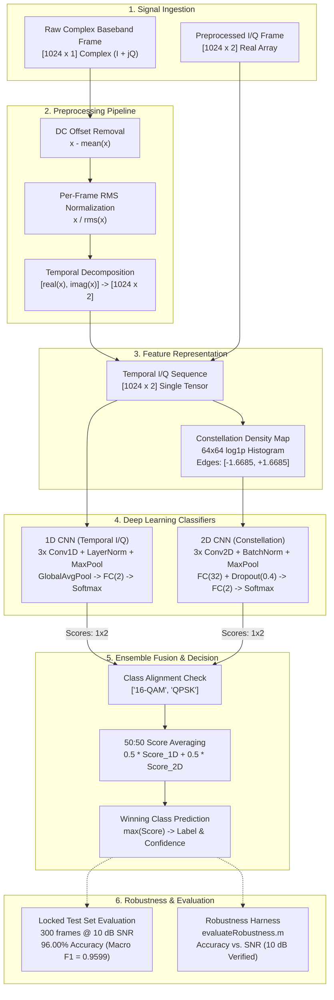

# MathWorks RF Signal Classifier (100% MATLAB)

[](https://www.mathworks.com/products/matlab.html)
[](https://www.mathworks.com/products/deep-learning.html)
[](https://www.mathworks.com/products/signal-processing.html)
[](LICENSE)
[](https://github.com/neilkdbn/Mathworks_RF_Classifier/tree/feature/anjali-robustness-evaluation)

A deep learning-based automatic modulation classification (AMC) system implemented strictly in **100% MATLAB** (no Python dependencies). The system classifies complex baseband radio frequency (RF) frames into digital modulation schemes under multipath Rayleigh fading and additive white Gaussian noise (AWGN) by combining temporal I/Q features and spatial constellation-density representations in an equal-weight deep learning ensemble.

---

## Table of Contents

1. [Project Overview](#project-overview)
2. [Key Capabilities](#key-capabilities)
3. [Team Members and Roles](#team-members-and-roles)
4. [System Architecture](#system-architecture)
5. [Repository Structure](#repository-structure)
6. [Dataset and RF Signal Generation](#dataset-and-rf-signal-generation)
7. [Preprocessing Pipeline](#preprocessing-pipeline)
8. [Model Architectures](#model-architectures)
9. [Inference and Ensemble Fusion](#inference-and-ensemble-fusion)
10. [Evaluation and Locked Test Results](#evaluation-and-locked-test-results)
11. [Robustness Analysis and Multi-SNR Gap](#robustness-analysis-and-multi-snr-gap)
12. [Installation and Prerequisites](#installation-and-prerequisites)
13. [Running the Project](#running-the-project)
14. [Reproducibility and Provenance](#reproducibility-and-provenance)
15. [Limitations, Defects, and Known Issues](#limitations-defects-and-known-issues)
16. [Troubleshooting Guide](#troubleshooting-guide)
17. [Future Roadmap](#future-roadmap)
18. [License and Citation](#license-and-citation)

---

## Project Overview

Automatic Modulation Classification (AMC) is a critical capability in cognitive radio, dynamic spectrum access, electronic warfare, and wireless monitoring. The objective is to identify the modulation type of an intercepted, unknown radio signal without requiring a priori demodulation or cooperative transmission metadata.

This repository implements a software-only RF modulation classification workflow developed as a collaborative college engineering project in MATLAB:
- **Baseband Signals:** Complex baseband frames ($I + jQ$) subject to multipath dispersion and noise.
- **Modulation Schemes Supported:** Binary classification between **QPSK** (Quaternary Phase Shift Keying) and **16-QAM** (16-ary Quadrature Amplitude Modulation).
- **Core Approach:** Dual-branch deep learning network ensemble:
  1. **1D CNN Branch:** Operates on normalized temporal in-phase and quadrature sequences ($1024 \times 2$).
  2. **2D CNN Branch:** Operates on spatial $64 \times 64$ log-histogram constellation-density images constructed with fixed bin edges derived solely from training data.
  3. **Decision Fusion:** Equal-weight (50:50) probability score averaging across networks.
- **Implementation Status:** Pretrained models, inference APIs, feature preprocessing routines, and held-out test evaluations are verified. Synthetic multi-SNR dataset generation and multi-SNR robustness curves remain partially implemented.

---

## Key Capabilities

| Capability | Implementation Status | Evidence / Location |
|---|---|---|
| **Dual-Path Inference API** | **Implemented & Verified** | `deep_learning/predict_rf_modulation.m`, `predict_rf_from_raw.m` |
| **Temporal 1D CNN Classifier** | **Implemented & Verified** | `models/rf_1dcnn_r2026b.mat` (95.33% test accuracy) |
| **Constellation-Density 2D CNN** | **Implemented & Verified** | `models/rf_2dcnn_constellation_r2026b.mat` (93.00% test accuracy) |
| **Equal-Weight Score Ensemble** | **Implemented & Verified** | 96.00% test accuracy on 300 held-out frames |
| **Phase 2 IQ Preprocessing** | **Implemented & Verified** | `preprocessing/remove_dc_offset.m`, `normalize_amplitude.m` |
| **Constellation Density Transform** | **Implemented & Verified** | `deep_learning/make_constellation_density.m` ($64 \times 64$ log-count) |
| **Deployment Smoke Test** | **Implemented & Verified** | `deep_learning/smoke_test_rf_ai_deployment.m` (no dataset required) |
| **Robustness Harness** | **Implemented (10 dB Only)** | `scripts/evaluateRobustness.m`, `test_evaluate_robustness.m` |
| **Multi-SNR Robustness Sweep** | **Not Implemented / Blocked** | Lacks multi-SNR dataset; generator contains `randn` stub |
| **End-to-End Pipeline Demo** | **Defect Blocked** | `scripts/mainRFClassifier.m:L25` argument mismatch |

---

## Team Members and Roles

The project was developed across four specialized functional roles:

| Member | Project Role | Git / Commit Identity | Verified Responsibilities & Contributions | Verification Evidence Source |
|---|---|---|---|---|
| **Neil Khadakban** | **RF Systems Modeler** | `neilkdbn`<br>`neilkhadakban@gmail.com` | Synthetic waveform generation, baseline channel impairments (Rayleigh fading, AWGN), initial project scaffold, and raw dataset generation script (`generate_signals.m`). | Initial commit `d002c29`, commit `a025295`, `scripts/generateRFSignalDataset.m:L2`, `README.md:L11`. |
| **Arya** | **Signal Processing Lead** | `Aryasurya12`<br>`aryasurya1309@gmail.com` | Phase 2 signal preprocessing (per-frame DC removal, RMS normalization, quality analysis) and Phase 3 feature representations (I/Q tensors, centered STFT spectrograms, AI handoff contract). | Commits `e31f5c0`–`e34a7ac`, `preprocessing/` package, `docs/ARYA_AI_FEATURE_CONTRACT.md`, `README.md:L12`. |
| **Shreeya** | **Deep Learning Architect** | `Shreeyacodes`<br>`jshreeya05@gmail.com` | Deep learning model design, training orchestration, 1D CNN on temporal I/Q, 2D CNN on constellation density, STFT overfit diagnosis, score ensemble logic, and deployment packaging. | Commits `7508d66`–`be3ad50`, `deep_learning/` modules, `docs/AI_HANDOVER_README.md`, `docs/AI_FINAL_RESULTS.md`, `README.md:L13`. |
| **Anjali Shewale** | **Project & Testing Lead / Integration & Robustness Lead** | `Anjalii146`<br>`anjalishewale1392@gmail.com` | Pipeline integration, MATLAB project configuration (`.prj`), single-operating-point robustness harness, locked test verification report, living plan curation, target branch maintenance. | Commits `c0f2e93`, `89fd066`–`2df37b6`, `results/EVALUATION_REPORT.md`, `scripts/setupRFClassifierProject.m`, `docs/plan.md`, `README.md:L14`. |

*Note on Affiliation:* Institutional affiliation is recorded in developer paths as a collegiate "Signals and Systems" engineering laboratory project. No university entity was formally declared in repository metadata.

---

## System Architecture

The following diagram illustrates the verified execution flow from input waveform through preprocessing, dual-model inference, decision fusion, and evaluation:



---

## Repository Structure

```text
Mathworks_RF_Classifier/
├── .gitignore                          # Git ignore rules (*.mat ignored except tracked models)
├── LICENSE                             # MIT License (Copyright 2026 RF Classifier Team)
├── README.md                           # Master repository documentation (this file)
├── RFClassifier.prj                    # Formal MATLAB Project definition XML
├── check_feature_reproducibility.m     # Verification script for feature metadata & numerical tolerance
├── inspect_models_and_data.m           # Inspection utility for model binaries, split metadata & seeds
├── test_evaluate_robustness.m          # Test harness verifying evaluateRobustness.m on 10 dB test split
│
├── data/
│   └── README.md                       # Instructions on dataset placement (datasets excluded from Git)
│
├── deep_learning/                      # Core Deep Learning module (Shreeya)
│   ├── diagnose_stft_overfit.m         # Diagnostic script testing STFT memorization on small subset
│   ├── diagnose_stft_spatial_head.m    # Diagnostic script evaluating STFT spatial classification head
│   ├── evaluate_rf_1dcnn.m             # Evaluation script for 1D CNN model checkpoint
│   ├── evaluate_rf_2dcnn_stft.m        # Evaluation script for legacy STFT 2D CNN
│   ├── evaluate_rf_final_locked.m      # Master held-out test evaluation script (generates final results)
│   ├── make_constellation_density.m    # Transforms 1024x2 I/Q into 64x64 log-density histogram image
│   ├── package_rf_ai_for_anjali.m      # Packaging utility bundling 14 deployment artifacts into delivery ZIP
│   ├── predict_rf_from_raw.m           # Inference API adapter for raw complex baseband [1024 x 1] vectors
│   ├── predict_rf_modulation.m         # Primary inference API for preprocessed [1024 x 2] I/Q frames
│   ├── prepare_rf_splits.m             # Stratified 70/15/15 dataset splitter (Seed 42, twister)
│   ├── smoke_test_rf_ai_deployment.m   # Standalone deployment smoke test (uses synthetic I/Q noise)
│   ├── smoke_test_rf_modulation.m      # Validation smoke test on 6 validation frames (requires dataset)
│   ├── train_rf_1dcnn.m                # Training script for 1D CNN using MATLAB trainnet
│   ├── train_rf_2dcnn_complex_stft.m   # Experimental 2-channel real/imag STFT CNN training script
│   ├── train_rf_2dcnn_constellation.m  # Training script for 2D Constellation CNN using trainnet
│   ├── train_rf_2dcnn_spatial.m        # Experimental spatial-head STFT CNN training script
│   └── train_rf_2dcnn_stft.m           # Experimental log-power STFT CNN training script
│
├── docs/                               # Architecture and integration contracts
│   ├── AI_FEATURE_CONTRACT.md          # Data shape and type specifications for deep learning handoff
│   ├── AI_FINAL_RESULTS.md             # Summary of frozen model comparisons and negative STFT results
│   ├── AI_HANDOVER_README.md           # Handover guide from Shreeya to Anjali with deployment steps
│   ├── AI_INTEGRATION_CONTRACT.md      # Interface specification and acceptance criteria for inference APIs
│   ├── ARYA_AI_FEATURE_CONTRACT.md     # Copy of Phase 3 feature handoff contract
│   └── plan.md                         # Living project roadmap and milestone tracker (Anjali)
│
├── models/                             # Trained deep learning model checkpoints (Tracked in Git)
│   ├── README.md                       # Information regarding model checkpoints
│   ├── rf_1dcnn_r2026b.mat             # Saved 1D CNN dlnetwork, split indices, and class metadata
│   └── rf_2dcnn_constellation_r2026b.mat # Saved 2D CNN dlnetwork, bin edges, and split metadata
│
├── preprocessing/                      # Signal processing & feature extraction package (Arya)
│   ├── analyze_signal_quality.m        # Computes DC level, RMS power, and PAPR quality metrics
│   ├── compute_stft.m                  # Computes centered STFT with 64-point Hamming window (75% overlap)
│   ├── extract_features.m              # Master feature extractor combining I/Q and STFT extraction
│   ├── extract_iq_features.m           # Formats complex frames into [1024 x 2 x N] 1D-CNN tensors
│   ├── extract_stft_features.m         # Generates [64 x 61 x N] log-power spectrograms
│   ├── load_rf_dataset.m               # Standardized dataset loader with Fs and SNR fallback handling
│   ├── normalize_amplitude.m           # Per-frame RMS amplitude normalizer with zero-energy guard
│   ├── preprocess_iq.m                 # Master Phase 2 preprocessing orchestrator
│   ├── remove_dc_offset.m              # Per-frame sample mean subtractor
│   ├── validate_ai_handoff.m           # Validates extracted features against contract requirements
│   ├── validate_features.m             # Checks tensor dimensions, finiteness, and class balance
│   └── validate_input.m                # Validates input structs for types, complex values, and NaN/Inf
│
├── results/                            # Frozen evaluation outputs and experimental evidence
│   ├── EVALUATION_REPORT.md            # Comprehensive model evaluation and robustness report (Anjali)
│   ├── final_locked_test_comparison.csv # Summary table of test accuracy and macro F1 scores
│   └── final_locked_test_comparison.mat # Binary artifact containing confusion matrices, actuals & predictions
│
├── scripts/                            # Legacy & Integration Scripts
│   ├── evaluateRobustness.m            # SNR-aware evaluation harness and confusion matrix generator
│   ├── extractRFfeatures.m             # Phase 1 legacy table feature extractor
│   ├── finish.m                        # MATLAB project shutdown placeholder
│   ├── generateRFSignalDataset.m       # Phase 1 synthetic generator (contains placeholder randn stub)
│   ├── generate_features.m             # Preprocessing & feature extraction runner for rf_dataset_v1.mat
│   ├── mainRFClassifier.m              # Legacy end-to-end pipeline script (contains call mismatch DEF-01)
│   ├── setupRFClassifierProject.m      # Formal MATLAB project creator (omits preprocessing/dl from path)
│   ├── startup.m                       # Project startup hook (omits preprocessing/dl from path)
│   └── trainRFClassifier.m             # Phase 1 legacy training script (uses deprecated trainNetwork)
│
├── tests/
│   └── testPipelineSmoke.m             # Integration smoke test (contains signature mismatch DEF-01)
│
└── utilities/
    └── README.md                       # Description of shared project utility folder
```

---

## Dataset and RF Signal Generation

### 1. Dataset Parameters (Active Evaluation Dataset)
The models were trained and evaluated on an established 2,000-frame synthetic baseband dataset (`rf_dataset_v1.mat` / `data/processed/rf_features_v1.mat`):
- **Total Frame Count:** 2,000 frames (balanced: 1,000 QPSK, 1,000 16-QAM).
- **Frame Length ($N$):** 1,024 complex baseband samples per frame ($I + jQ$).
- **Baseband Sampling Rate ($F_s$):** $1.0\text{ MHz}$ ($1 \times 10^6\text{ samples/sec}$).
- **Oversampling Ratio ($sps$):** 8 samples per symbol ($1024 / 8 = 128\text{ symbols/frame}$).
- **Pulse Shaping Filter:** Raised Cosine Transmit Filter (`comm.RaisedCosineTransmitFilter`) with roll-off factor $\beta = 0.35$ and filter span of 6 symbols.
- **Multipath Fading Channel:** Rayleigh Fading (`comm.RayleighChannel`) with:
  - Discrete path delays: $[0,\; 1.5,\; 3.2]\;\mu\text{s}$
  - Average path gains: $[0,\; -3,\; -10]\;\text{dB}$
  - Maximum Doppler shift: $50\text{ Hz}$
- **Noise Channel:** Additive White Gaussian Noise (`awgn`) at a fixed target SNR of **10 dB** (`measured`).

### 2. Signal Generation Provenance
The raw dataset was synthesized using Neil Khadakban's generation script (`generate_signals.m`, commit `a025295` on `main`):
```matlab
% QPSK Modulation (pi/4 constellation rotation)
modSignal = pskmod(dataSymbols, 4, pi/4);
% 16-QAM Modulation (unit average power)
modSignal = qammod(dataSymbols, 16, 'UnitAveragePower', true);
```
Both signal sets were passed through the transmit pulse shaping filter, the Rayleigh channel, truncated to 1,024 samples, and corrupted with 10 dB AWGN.

> [!WARNING]
> **Defect DEF-02 (Placeholder Modulator Stub):**  
> The generation script in `scripts/generateRFSignalDataset.m` is a Phase 1 prototype. Lines 73–78 implement:
> ```matlab
> switch modType
>     case "PAM4"
>         tx = (randi([0 3], N, 1)*2 - 3) + 0j;
>     otherwise
>         tx = (randn(N,1) + 1j*randn(N,1)) / sqrt(2);
> end
> ```
> For all modulation classes other than PAM4, this script generates **complex Gaussian noise**. Do not use `scripts/generateRFSignalDataset.m` to generate training or test data until genuine modulators are implemented.

### 3. Dataset Artifact Status
Under the repository's `.gitignore` policy (`*.mat`), large raw dataset files (`rf_dataset_v1.mat` and `data/processed/rf_features_v1.mat`) are not committed to git. However, the trained model binaries (`models/*.mat`) and locked evaluation results (`results/*.mat`, `results/*.csv`) **are** committed and tracked.

---

## Preprocessing Pipeline

The preprocessing pipeline (implemented in `preprocessing/`) transforms raw complex baseband signals into network-ready tensors:

```text
Raw Baseband [1024x1 complex]
     │
     ▼
[Step 1] validate_input.m           --> Checks dimensions, complex datatype, NaN/Inf
     │
     ▼
[Step 2] remove_dc_offset.m         --> x_clean = x - mean(x)
     │
     ▼
[Step 3] normalize_amplitude.m      --> x_norm = x_clean / rms(x_clean)  [near-zero floor: 1e-12]
     │
     ├─────────────────────────────────────────────────┐
     ▼                                                 ▼
[Step 4a] extract_iq_features.m             [Step 4b] make_constellation_density.m
  - I = real(x_norm)                          - Clip I, Q to [-1.6685, +1.6685]
  - Q = imag(x_norm)                          - 2D histogram (64x64 bins)
  - Tensor: [1024 x 2] single                 - Log-count: log1p(histcounts2)
     │                                        - Image: [64 x 64 x 1] single
     ▼                                                 ▼
Input to 1D CNN Classifier                  Input to 2D CNN Classifier
```

### Mathematical Definitions

1. **DC Offset Removal (`remove_dc_offset.m`):**
   Removes receiver local-oscillator (LO) leakage and carrier feedthrough per frame:
   $$\bar{x} = \frac{1}{N}\sum_{n=1}^N x[n], \quad x_{\text{clean}}[n] = x[n] - \bar{x}$$
2. **RMS Amplitude Normalization (`normalize_amplitude.m`):**
   Standardizes signal power while preserving constellation peak-to-average ratios (critical for distinguishing QPSK from 16-QAM):
   $$\sigma_{\text{rms}} = \sqrt{\frac{1}{N}\sum_{n=1}^N |x_{\text{clean}}[n]|^2}, \quad x_{\text{norm}}[n] = \frac{x_{\text{clean}}[n]}{\max(\sigma_{\text{rms}},\, 10^{-12})}$$
3. **Constellation Density Histogram (`make_constellation_density.m`):**
   Converts normalized samples into a spatial density grid. To eliminate test leakage, histogram bin edges are frozen from training statistics:
   $$\text{Range: } [-R, +R], \quad R = 1.6685 \quad (99.5\text{th percentile of } \max(|I|, |Q|) \text{ on training split})$$
   The 64 bins span $[-1.6685, +1.6685]$. Samples outside the range are clipped to boundaries. The image intensity is:
   $$\mathbf{X}_{\text{2D}}[u, v] = \ln(1 + \text{histcounts2}(I, Q, \text{edges}))$$

> [!NOTE]
> **STFT Spectrogram Features (`preprocessing/extract_stft_features.m`):**  
> Centered STFT log-power spectrograms ($64 \times 61$) were evaluated during Phase 3/5. Although STFT extraction is fully functional, all STFT-based 2D CNN architectures suffered from severe overfitting or single-class collapse (documented in [Model Architectures](#model-architectures)). Consequently, the final deployed 2D network uses Constellation Density maps instead of STFT.

---

## Model Architectures

### 1. 1D CNN Classifier (Temporal In-Phase / Quadrature)
- **Model Checkpoint:** `models/rf_1dcnn_r2026b.mat`
- **Input Representation:** Preprocessed temporal I/Q sequence ($[1024 \times 2]$ single).
- **Architecture Details:**
  - `sequenceInputLayer(2, Normalization="none", MinLength=1024)`
  - `convolution1dLayer(5, 16, Padding="same")` $\rightarrow$ `reluLayer` $\rightarrow$ `layerNormalizationLayer` $\rightarrow$ `maxPooling1dLayer(4, Stride=4)`
  - `convolution1dLayer(5, 32, Padding="same")` $\rightarrow$ `reluLayer` $\rightarrow$ `layerNormalizationLayer` $\rightarrow$ `maxPooling1dLayer(4, Stride=4)`
  - `convolution1dLayer(5, 64, Padding="same")` $\rightarrow$ `reluLayer`
  - `globalAveragePooling1dLayer`
  - `fullyConnectedLayer(2)` $\rightarrow$ `softmaxLayer`
- **Training Hyperparameters:** `trainnet` with Adam optimizer, loss: `crossentropy`, MaxEpochs = 12, MiniBatchSize = 32, InitialLearnRate = 0.001, ValidationFrequency = 20 iterations, OutputNetwork = "best-validation".

### 2. 2D CNN Classifier (Constellation Density Map)
- **Model Checkpoint:** `models/rf_2dcnn_constellation_r2026b.mat`
- **Input Representation:** $64 \times 64 \times 1$ single log-count constellation density image.
- **Architecture Details:**
  - `imageInputLayer([64 64 1], Normalization="none")`
  - `convolution2dLayer(3, 16, Padding="same")` $\rightarrow$ `batchNormalizationLayer` $\rightarrow$ `reluLayer` $\rightarrow$ `maxPooling2dLayer(2, Stride=2)`
  - `convolution2dLayer(3, 32, Padding="same")` $\rightarrow$ `batchNormalizationLayer` $\rightarrow$ `reluLayer` $\rightarrow$ `maxPooling2dLayer(2, Stride=2)`
  - `convolution2dLayer(3, 64, Padding="same")` $\rightarrow$ `batchNormalizationLayer` $\rightarrow$ `reluLayer` $\rightarrow$ `maxPooling2dLayer(2, Stride=2)`
  - `fullyConnectedLayer(32)` $\rightarrow$ `reluLayer` $\rightarrow$ `dropoutLayer(0.4)`
  - `fullyConnectedLayer(2)` $\rightarrow$ `softmaxLayer`
- **Training Hyperparameters:** `trainnet` with Adam optimizer, loss: `crossentropy`, MaxEpochs = 20, MiniBatchSize = 32, InitialLearnRate = 0.0005, L2Regularization = 0.0001, ValidationFrequency = 44 iterations, ValidationPatience = 6, OutputNetwork = "best-validation".

### 3. Documented Negative Results (Experimental STFT Models)
During Phase 5 development, Shreeya explored three STFT-based 2D CNN architectures on $64 \times 61$ spectrograms (`docs/AI_FINAL_RESULTS.md`):
1. **Log-Power STFT 2D CNN with Global Average Pooling:** Reached 50.0% validation accuracy (single-class collapse predicting only 16-QAM).
2. **Log-Power STFT 2D CNN with Spatial Head:** Severe training-validation overfitting (train loss collapsed, validation remained near 50%).
3. **Complex Real/Imaginary 2-Channel STFT 2D CNN:** Validation accuracy plateaued at 51.0%.

*Scientific Explanation:* Single-carrier QPSK and 16-QAM with identical pulse shaping share essentially identical power spectral density (PSD) profiles across time. STFT magnitude spectrograms discard symbol-transition constellation geometry while capturing noisy spectral fluctuations. Constellation-density histograms directly preserve constellation cluster geometry, resolving this failure mode.

---

## Inference and Ensemble Fusion

### Dual Inference APIs

1. **Preprocessed I/Q API (`deep_learning/predict_rf_modulation.m`):**
   ```matlab
   % Input: [1024 x 2] real array (col 1 = I, col 2 = Q), DC-removed & RMS-normalized
   result = predict_rf_modulation(iqFrame);
   fprintf('Predicted Modulation: %s (Score: %.4f)\n', result.label, result.predictedScore);
   ```
2. **Raw Complex Baseband Adapter (`deep_learning/predict_rf_from_raw.m`):**
   ```matlab
   % Input: [1024 x 1] complex vector (I + jQ) at baseband
   result = predict_rf_from_raw(rawComplexFrame);
   fprintf('Predicted Modulation: %s\n', result.label);
   ```

### Ensemble Fusion Strategy
- **Weighting:** Equal-weight 50:50 score averaging:
  $$\mathbf{S}_{\text{ensemble}} = 0.5 \cdot \mathbf{S}_{\text{1D}} + 0.5 \cdot \mathbf{S}_{\text{2D}}$$
- **Class Alignment:** The API explicitly maps class indices by stored names (`["16-QAM", "QPSK"]`) before summing scores, avoiding indexing mismatches.
- **Model Caching:** Model weights are cached in MATLAB `persistent` memory upon initial invocation, amortizing disk I/O across repeated inferences.

---

## Evaluation and Locked Test Results

All models were evaluated in inference-only mode on the 300 held-out test frames (150 QPSK, 150 16-QAM) generated from partition seed `42` (`results/final_locked_test_comparison.csv` and `.mat`):

### 1. Performance Summary Table

| Model | Test Accuracy | Test Correct | Macro F1 | 16-QAM Recall | QPSK Recall | 16-QAM Precision | QPSK Precision |
|---|---|---|---|---|---|---|---|
| **1D CNN (Temporal I/Q)** | 95.33% | 286 / 300 | 0.9533 | 98.67% (148/150) | 92.00% (138/150) | 92.50% (148/160) | 98.57% (138/140) |
| **2D CNN (Constellation)** | 93.00% | 279 / 300 | 0.9299 | 97.33% (146/150) | 88.67% (133/150) | 89.57% (146/163) | 97.08% (133/137) |
| **Equal-Weight Ensemble** | **96.00%** | **288 / 300** | **0.9599** | **100.0% (150/150)** | **92.00% (138/150)** | **92.59% (150/162)** | **100.0% (138/138)** |

### 2. Confusion Matrices (Held-Out Test Set)
*Rows = True Modulation, Columns = Predicted Modulation. Class ordering: `[16-QAM, QPSK]`.*

#### 1D CNN Classifier:
| True \ Pred | 16-QAM | QPSK | Class Total |
|---|---|---|---|
| **16-QAM** | **148** | 2 | 150 |
| **QPSK** | 12 | **138** | 150 |

#### 2D Constellation CNN:
| True \ Pred | 16-QAM | QPSK | Class Total |
|---|---|---|---|
| **16-QAM** | **146** | 4 | 150 |
| **QPSK** | 17 | **133** | 150 |

#### Equal-Weight Ensemble (50:50):
| True \ Pred | 16-QAM | QPSK | Class Total |
|---|---|---|---|
| **16-QAM** | **150** | **0** | 150 |
| **QPSK** | 12 | **138** | 150 |

### 3. Key Observations
1. **Zero False Positives for 16-QAM in Ensemble:** The ensemble correctly classified 100% of 16-QAM test frames (150/150).
2. **Error Pattern:** All 12 errors made by the ensemble are QPSK signals misclassified as 16-QAM due to severe multipath fading scattering QPSK constellation points.
3. **Marginal Ensemble Gain:** The ensemble improves over the standalone 1D CNN by exactly 2 test frames (288 vs 286, a 0.67% absolute gain). As noted in `results/EVALUATION_REPORT.md`, this margin does not demonstrate statistically significant superiority.

---

## Robustness Analysis and Multi-SNR Gap

### 1. Operating Point Status (Verified vs Unverified)
- **Operating Point Evaluated:** Single operating point at **$\text{SNR} = 10\text{ dB}$**.
- **Multi-SNR Robustness:** **Not verified / unmeasured.**
- Neither `rf_dataset_v1.mat` nor `rf_features_v1.mat` contains multi-SNR sweeps (e.g. $-10\text{ dB}$ to $+20\text{ dB}$).
- Performance below 10 dB (where noise power approaches or exceeds signal power) cannot be inferred from 10 dB metrics.

### 2. Robustness Harness Verification
The robustness evaluation script `scripts/evaluateRobustness.m` was executed on the locked 10 dB test set (`test_evaluate_robustness.m`). It successfully validated tabular output grouping:
```text
Overall classification accuracy: 0.9600
    snrDb    accuracy    numFrames
    _____    ________    _________
     10        0.96         300   
```
Once multi-SNR test frames are provided, `evaluateRobustness.m` is fully operational to generate accuracy-vs-SNR waterfall curves and per-SNR confusion matrices.

---

## Installation and Prerequisites

### MATLAB Version & Toolboxes
- **Target Release:** MATLAB R2026b (fully supported and verified in codebase) or MATLAB R2024b.
- **Required Toolboxes:**
  - **Deep Learning Toolbox** (for `trainnet`, `dlnetwork`, `minibatchpredict`, `layerNormalizationLayer`)
  - **Signal Processing Toolbox** (for `stft`, `rms`, `hamming`, `histcounts2`)
  - **Communications Toolbox** (for `pskmod`, `qammod`, `comm.RayleighChannel`, `comm.RaisedCosineTransmitFilter`, `awgn`)

### Clone and Environment Setup
```bash
git clone https://github.com/neilkdbn/Mathworks_RF_Classifier.git
cd Mathworks_RF_Classifier
git checkout feature/anjali-robustness-evaluation
```

---

## Running the Project

### 1. Standalone Deployment Smoke Test (No Dataset Required)
Tests loading model checkpoints, running preprocessing, and generating predictions using synthetic test I/Q vectors:
```matlab
% In MATLAB Command Window:
addpath('deep_learning');
addpath('preprocessing');
run('deep_learning/smoke_test_rf_ai_deployment.m');
```
*Expected Output:* `DEPLOYMENT API SMOKE TEST PASSED.`

### 2. Classifying a Custom RF Baseband Signal
```matlab
addpath('deep_learning');
addpath('preprocessing');

% Example: Complex baseband vector of 1024 samples
rawFrame = complex(randn(1024, 1), randn(1024, 1)); 

% Predict using raw adapter
result = predict_rf_from_raw(rawFrame);

fprintf('Predicted Class: %s\n', result.label);
fprintf('Ensemble Scores: %s=%.4f, %s=%.4f\n', ...
    result.classNames(1), result.classScores(1), ...
    result.classNames(2), result.classScores(2));
```

### 3. Verifying the 10 dB Robustness Harness
```matlab
addpath('scripts');
run('test_evaluate_robustness.m');
```

### 4. Creating the Deployment Handover Package
To bundle model binaries, inference code, and documentation into `RF_AI_Anjali_Delivery.zip`:
```matlab
addpath('deep_learning');
zipPath = package_rf_ai_for_anjali();
```

### 5. Workflows Currently Blocked or Requiring Local Data
- **End-to-End Pipeline Demo (`scripts/mainRFClassifier.m`):** Currently blocked by defect [DEF-01](#limitations-defects-and-known-issues). See remediation below.
- **Retraining Models from Scratch (`train_rf_1dcnn.m`, `train_rf_2dcnn_constellation.m`):** Requires `data/processed/rf_features_v1.mat`. Generate or obtain this file before running training scripts.

---

## Reproducibility and Provenance

1. **Partitioning Determinism:** Stratified splitting in `deep_learning/prepare_rf_splits.m` uses `rng(42, 'twister')`. The generated partition vectors (`trainIdx`: 1,400, `valIdx`: 300, `testIdx`: 300) match the partition indices stored inside `models/rf_1dcnn_r2026b.mat` and `models/rf_2dcnn_constellation_r2026b.mat`.
2. **Inference Numerical Consistency:** Discrete predictions reproduced by `evaluate_rf_final_locked.m` are identical to historical results preserved in `results/backup_before_rerun/`. Maximum score difference across all 300 test frames was $< 4 \times 10^{-6}$ (floating-point precision limit).
3. **Scientific Provenance Caveat:** As documented in `results/EVALUATION_REPORT.md`, matching split indices and backup predictions establishes code and weight preservation, but does not cryptographically prove that newly regenerated features from raw signals match the original training features without a SHA-256 data hash.

---

## Limitations, Defects, and Known Issues

The following defects and limitations have been verified through static and artifact audits:

| Issue ID | Severity | File / Function | Description & Impact | Recommended Remediation |
|---|---|---|---|---|
| **DEF-01** | **Critical** | `scripts/mainRFClassifier.m:L25`<br>`tests/testPipelineSmoke.m:L15` | Calls `evaluateRobustness(net, feats, info.TestIdx, ...)` instead of `(trueLabels, predictedLabels, snrValues)`. Fails with `Undefined function 'categorical' for input of type 'SeriesNetwork'` and size mismatch. | Update caller to: `yPred = classify(net, XTest); evaluateRobustness(feats.modulation(info.TestIdx), yPred, feats.snrDb(info.TestIdx))` |
| **DEF-02** | **Critical** | `scripts/generateRFSignalDataset.m:L77` | Modulator fallback returns complex Gaussian noise `(randn + 1j*randn)/sqrt(2)` for all modulations except PAM4. Cannot generate valid modulation waveforms. | Implement genuine modulation bank (`pskmod`, `qammod`) with RRC transmit filtering. |
| **DEF-03** | **High** | `preprocessing/preprocess_iq.m:L63` | Calls `apply_filter(current_signals, dataStruct.Fs, options.filter)` when `options.filter.enable = true`. `apply_filter.m` does not exist in the repository. | Implement `apply_filter.m` or remove dead filter call. |
| **DEF-04** | **High** | `scripts/setupRFClassifierProject.m:L25`<br>`scripts/startup.m:L5` | Omits `deep_learning/` and `preprocessing/` from the MATLAB project path list. Functions cannot be called without manual `addpath`. | Add `'deep_learning'` and `'preprocessing'` to `pathFolders` in both files. |
| **DEF-05** | **Medium** | `preprocessing/validate_ai_handoff.m:L18`<br>`preprocessing/validate_features.m:L32` | Hardcodes `expectedFrames = 2000` (1000 QPSK / 1000 16-QAM). Fails validation on datasets of any other frame count or multi-SNR size. | Parameterize validation against `size(features.signals, 2)`. |
| **DEF-06** | **Medium** | `scripts/generate_features.m:L4` | Uses relative path `addpath('../preprocessing')` and `../rf_dataset_v1.mat`. Fails if executed from the repository root instead of `scripts/`. | Use `fileparts(fileparts(mfilename('fullpath')))` to resolve root paths. |
| **DEF-07** | **Medium** | `scripts/trainRFClassifier.m:L47` | Uses legacy `trainNetwork` and `classificationLayer` instead of modern `trainnet` (R2024b/R2026b). Incompatible with `dlnetwork` workflows. | Modernize training code to use `trainnet`. |
| **DEF-08** | **Medium** | `rf_dataset_v1.mat`<br>`data/processed/rf_features_v1.mat` | Large datasets are excluded from Git by `.gitignore` (`*.mat`). Retraining and test evaluation scripts require these files to run. | Host benchmark datasets on GitHub Releases or Git LFS. |
| **DEF-09** | **Low** | `docs/plan.md:L21` | Contains stale reference questioning if repository URL `neilkdbn/Mathworks_RF_Classifier` is a 404. | Update status to reflect active repository and branch. |

---

## Troubleshooting Guide

### 1. `Undefined function 'categorical' for input arguments of type 'SeriesNetwork'`
- **Cause:** Running `scripts/mainRFClassifier.m` or `tests/testPipelineSmoke.m` triggers DEF-01.
- **Fix:** In `scripts/mainRFClassifier.m`, replace Line 25 with:
  ```matlab
  % Extract test features and predict
  XTest = X(:,:,:,info.TestIdx);
  YPred = classify(net, XTest);
  YTrue = feats.modulation(info.TestIdx);
  snrTest = feats.snrDb(info.TestIdx);
  results = evaluateRobustness(YTrue, YPred, snrTest, 'Plot', true);
  ```

### 2. `Undefined function 'predict_rf_modulation'`
- **Cause:** `deep_learning/` is not on the MATLAB path (DEF-04).
- **Fix:** Run:
  ```matlab
  root = pwd; % or repository root
  addpath(fullfile(root, 'deep_learning'));
  addpath(fullfile(root, 'preprocessing'));
  ```

### 3. `Feature file missing. Run scripts/generate_features.m first.`
- **Cause:** Attempting to run retraining or full evaluation when `data/processed/rf_features_v1.mat` is absent.
- **Fix:** For inference and deployment testing, run `deep_learning/smoke_test_rf_ai_deployment.m`, which operates without dataset files.

---

## Future Roadmap

1. **Digital Modulator Bank:** Replace `scripts/generateRFSignalDataset.m` noise stubs with genuine Communications Toolbox modulators for BPSK, QPSK, 8-PSK, 16-QAM, 64-QAM, and GFSK.
2. **Multi-SNR Dataset Generation:** Synthesize test frames across $-10\text{ dB}$ to $+20\text{ dB}$ in $2\text{ dB}$ increments.
3. **SNR Waterfall Curves:** Execute `evaluateRobustness.m` across the complete SNR sweep to establish the operational SNR threshold.
4. **Hardware Testing:** Validate inference latency and throughput on software-defined radio (SDR) hardware (e.g. ADALM-PLUTO, RTL-SDR, USRP).

---

## License and Citation

### License
This project is licensed under the **MIT License** — see the [LICENSE](LICENSE) file for details.

### Citation
If utilizing this project or its experimental findings in academic work or MATLAB benchmarking, please cite:
```bibtex
@software{mathworks_rf_classifier_2026,
  author = {Neil Khadakban and Arya and Shreeya and Anjali Shewale},
  title = {MathWorks RF Signal Classifier: Multi-Representation Deep Learning Modulation Classification in 100\% MATLAB},
  year = {2026},
  url = {https://github.com/neilkdbn/Mathworks_RF_Classifier/tree/feature/anjali-robustness-evaluation}
}
```

### Reference Design
- MathWorks: *Modulation Classification with Deep Learning* (`openExample('comm/ModulationClassificationWithDeepLearningExample')`).
